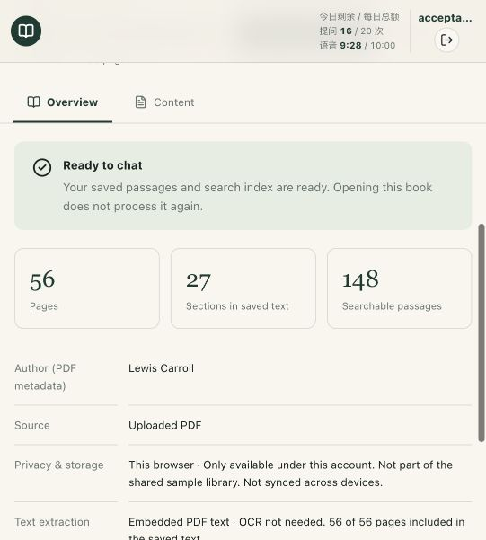
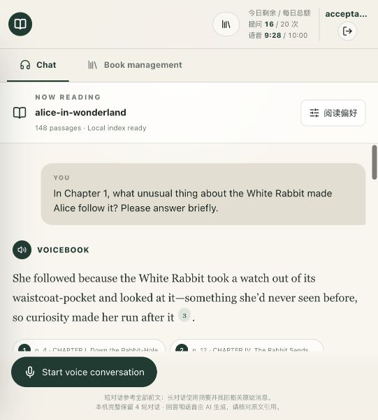

# Public book submission acceptance

[中文](README.zh-CN.md) · [Live app](https://voicebook-rag-demo.deep-hare-2593.chatgpt.site) · [70-second demo](demo.mp4) · [Test PDF](../../output/pdf/alice-in-wonderland.pdf)

On 19 October 2026, the deployed app accepted a fresh **complete 12-chapter PDF**, built its index, and answered four microphone questions. Three factual answers matched the book; an unsupported question did not invent a number. Citation navigation reached the original PDF, and all four turns survived refresh. This supports the core assignment submission as a controlled demo, not unrestricted production readiness.

## Reviewer route

1. Open the live app. Create a regular account, or use the backup reviewer credentials supplied privately. No ChatGPT account or personal API key is required. Self-registration has two places per Singapore calendar day; the administrator-created backup account does not consume one.
2. Download [Alice's Adventures in Wonderland](../../output/pdf/alice-in-wonderland.pdf), then choose **Upload a PDF**. This is the full 12-chapter story, not a short built-in sample.
3. Wait for **Local index ready**. This file produced 56 pages and 148 searchable passages. **27 detected sections is not 27 chapters**: front matter, verse and license headings are also detected.
4. Press **Start voice conversation**, permit the microphone, and ask a [test question](alice-cases.json). Pause after speaking. The transcript appears in chat and sends automatically; the answer should play without a second send action. Headphones are recommended for ordinary use.
5. End voice, open a citation, then select **View in book → View PDF page**. For the mushroom question, check physical PDF page 18.
6. Refresh and reselect the saved book. The index and conversation remain in this browser under this account. A different browser/device starts a separate library.

Regular accounts default to 20 questions / 10 input voice minutes per day, subject to the shared site budget. The backup reviewer account was login-verified with its entire allowance unused; its password is deliberately absent from GitHub. A separate acceptance account consumed four questions and 32 billed input seconds, including an incidental empty segment. No quotas were reset.

## Fixture and provenance

Lewis Carroll's text comes from [Project Gutenberg eBook 11](https://www.gutenberg.org/ebooks/11), retrieved 19 October 2026. The catalog lists it as public domain in the USA; check applicable law outside the USA. Original notices and the complete Gutenberg license accompany the [source text](source/pg11.txt) and PDF. This third-party text is not relicensed as project code.

This is a new text-only layout of all 12 story chapters, not a historical facsimile. Pages 1–2 are front matter; chapter I begins on page 3; the license follows chapter XII. Gold pages apply only to the committed PDF. The [manifest](alice-manifest.json) records chapter ranges and source/PDF SHA-256 hashes. The [generator](../../scripts/build-acceptance-pdf.py) uses ReportLab + pypdf; override `ACCEPTANCE_FONT` and `ACCEPTANCE_BOLD_FONT` on other systems. Changing fonts/environment can change pagination and hashes.

## Actual results

Environment: deployed **v28**, code release `05473c1`, documentation baseline `08c48b2`, Codex in-app browser on macOS. Existing live ASR, embedding, answer and TTS providers were used. Input was macOS Samantha synthetic English speech played through speakers into the **real microphone**, not a mocked microphone stream or route-only test.

Upload started at 18:38:20 Singapore time; readiness was observed at 18:38:43. This is a polling-bound observation, not an exact latency benchmark. All 56 pages had embedded text; **this fixture did not exercise OCR**. Questions were observed around 18:45–18:47, with citation/refresh checks at 18:48. [Browser observations](browser-observations.json) use UTC timestamps and contain only this public-book test.

| Question | Observed answer | Source check |
| --- | --- | --- |
| Why follow the White Rabbit? | Its watch and waistcoat-pocket aroused Alice's curiosity. | Inline citation 3: p. 3, chapter I. Correct. |
| What do the mushroom's two sides do? | One makes her taller; the other shorter. One-sentence request respected. | Inline citation 2: p. 18, chapter V. Drawer → highlighted passage on list page 4/13 → rendered PDF p. 18 verified. |
| Why always six at the tea party? | The Hatter quarrelled with Time, which refuses to cooperate; it remains tea-time. | Citations 3 and 5: p. 28 and pp. 28–29, chapter VII. Support the explanation and unwashed tea things. |
| Alice's father's exact annual salary? | The supplied excerpts contain no salary figure. No amount or web-search claim invented. | Appropriate refusal, but unnecessary citations to all six retrieved passages. They do not prove a book-wide absence. |

All four intended utterances were semantically transcribed and automatically submitted. **Playing the answer** was directly observed on turns one and three. Turns two and four completed with saved audio available; full playback was not continuously observed. No extra assistant-generated user message appeared. An initial empty/no-words segment did not block the valid utterance. This does not establish human speech accuracy, an echo-error rate or human barge-in reliability. Four questions are a smoke set, not the proposed 25-question benchmark.

The microphone was explicitly ended. Refresh/reselection restored all four turns, 148 passages and **Local index ready**, without another upload or processing progress state. No reload network trace was collected; index reuse is additionally covered by storage regression tests. Initial microphone permission waiting was resolved by the owner. A separate Chrome automation upload was blocked by its extension's file-URL setting; no Chrome permissions were changed, and the completed flow used the in-app browser.

## Evidence and demo

The [silent 70-second MP4](demo.mp4) is an English-captioned walkthrough of **actual acceptance screenshots**, not continuous screen/audio recording. [Chinese subtitles](demo.zh-CN.srt) are included. It shows readiness, transcription, answers, citations, PDF navigation and refusal; it does not demonstrate playback sound or barge-in. Rebuild with `python3 scripts/build-acceptance-demo.py` using FFmpeg/libx264/drawtext; override `FFMPEG` and `DEMO_FONT` if needed.

Additional evidence: [transcription](images/microphone-level.png), [source drawer](images/citation-passage.png), [PDF navigation](images/pdf-page18.png), [refusal](images/unsupported-answer.png).

## Release checks and limits

The existing **125 offline tests passed again**, and `tsc --noEmit` passed on 19 October. This submission adds fixtures/docs/media only, not application behavior or a new deployment. See [evaluation](../EVALUATION.md), [architecture](../ARCHITECTURE.md), [AI collaboration](../AI_WORKFLOW.md) and [operations](../OPERATIONS.md).

The assignment values retrieval quality, architecture, disciplined AI collaboration and polished UX more than feature count. Remaining priorities are reducing irrelevant evidence/citations, human/device acoustic evaluation and the larger gold-page benchmark. Browser storage and operational quotas still limit very large PDFs; the assignment's lack of a size limit does not imply unlimited capacity.
